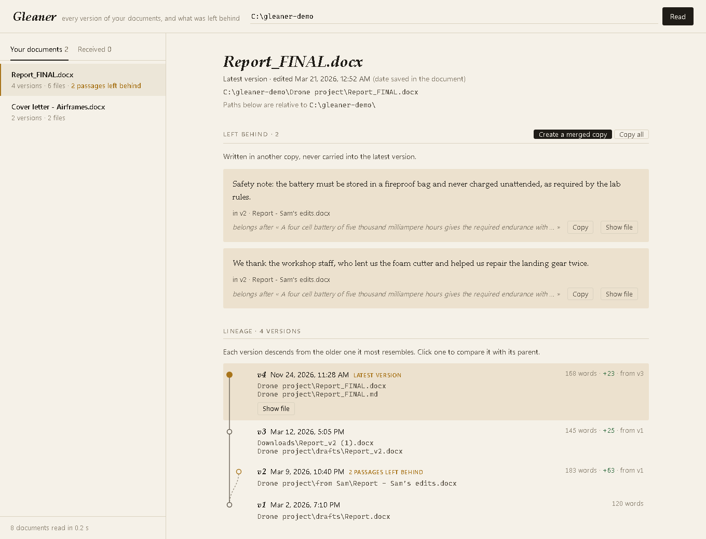

# Gleaner

**Find every version of your documents, see which one is the latest, and recover the passages left behind in older copies.**



`Report.docx`, `Report_v2.docx`, `Report_v2 (1).docx` in Downloads, `Report - Sam's edits.docx` that came back by email, `Report_FINAL.docx` and its PDF export.
Everyone who writes on a computer ends up here. File names lie, dates get reset by copies and downloads, and nobody remembers which copy has what.

Duplicate finders tell you which files are *identical*. That is the easy case. Gleaner deals with the hard one, files that are **different versions of the same document**:

- **Families.** It reads the text of your Word, PowerPoint, LibreOffice, PDF, Markdown, LaTeX and text files and groups the ones that are versions of each other, whatever their names and folders. A `.docx` and its PDF export count as one version.
- **Lineage.** It rebuilds who descends from whom: each version's parent is the older version it most resembles. Side copies (the one you emailed, the one on the USB stick) show up as branches.
- **Left behind.** This is the part no other tool does. Gleaner looks for paragraphs that were written in a side copy and **never made it into the latest version**, for example the section your teammate added to the copy you sent them, after you had already moved on with your own. It tells you where each one belongs ("belongs after: …") so you can paste it back.
- **Deleted on purpose** is kept apart: a paragraph removed on the latest version's own line was probably cut deliberately, so it is listed, folded away, and not raised as a problem.
- **Compare** any two versions, paragraph by paragraph and word by word.

Everything runs on your computer. Gleaner never modifies, moves or deletes a file, and nothing is sent anywhere.

## Install

Python 3.9 or newer.

```
pip install "gleaner-docs[pdf] @ git+https://github.com/ThyZ0/gleaner"
```

`[pdf]` adds PDF reading (the `pypdf` package). Without it, PDFs are skipped and listed as unreadable; every other format needs nothing beyond Python.

Uninstall: `pip uninstall gleaner-docs`, then delete the cache folder `~/.gleaner` (it holds the extracted text, so rescans are fast).

## Use

```
gleaner                      # opens the app on Documents, Desktop, Downloads and OneDrive
gleaner "D:\School" "E:\"    # or on the folders you choose
```

The app opens in your browser at `http://127.0.0.1:7341`. Documents with passages left behind come first, then the most recently edited ones. Families made only of PDFs are put in a separate **Received** tab: they are usually papers you were given (exam subjects and their corrections, for instance), not documents you wrote.

From the terminal:

```
gleaner scan [FOLDER...]           # every family, latest file of each
gleaner show FILE [FOLDER...]      # the story of one document: versions, and what was left behind
```

Both accept `--json`.

To try it on made-up files first: `python demo/make_demo.py C:\gleaner-demo` then `gleaner C:\gleaner-demo`.

### With Claude Code

The repository is also a Claude Code plugin. Its skill lets Claude answer questions such as *"which is the latest version of my internship report, and did I lose anything?"* by running `gleaner show`. Install the Python package first, then add the plugin:

```
/plugin marketplace add ThyZ0/gleaner
/plugin install gleaner@gleaner
```

## How it works

1. **Reading.** Office and LibreOffice files are zip archives of XML, read with the standard library. PDFs have no paragraphs, so they are rebuilt from lines ending a sentence. Cloud-only OneDrive files are skipped (opening them would download them), as are program logs and software licence files. Text and modification date are cached in `~/.gleaner/cache.json`; only new or changed files are read again, in parallel.
2. **Families.** Each document becomes a set of 5-word runs. Two documents are versions of each other when they share a large part of their text (Jaccard ≥ 0.35), or when one contains almost all of the other (≥ 80 %, so a two-page draft joins its ten-page final) while still sharing a minimum overall. Shared boilerplate (a school cover page, exam instructions) is not enough. Candidate pairs come from a fixed sample of one run in eight, then are checked on the full text.
3. **Versions.** Files with the same text, or the same text in another format, are one version. Its date is the date saved inside the document when there is one (Word and LibreOffice keep it), otherwise the file's date.
4. **Lineage.** The parent of each version is the most similar older version. The latest version and its ancestors form the main line.
5. **Left behind.** A paragraph of another version is still "in" the latest when most of its 3-word runs are found there, wherever the latest version's format cut its paragraphs. Paragraphs that are not are classified:
   - only ever in side copies → **left behind**, with the last paragraph before it that the latest still has;
   - present on the main line and gone since → **deleted along the way**.

   If the newest file is not the one you consider the latest (say, an old copy you re-downloaded), pick another version with **Treat as latest** and everything is recomputed.

## Limits

- Matching is on words, not meaning: a paragraph rewritten from scratch counts as deleted plus added.
- Scanned PDFs without a text layer cannot be compared. Encrypted files are listed as unreadable.
- Excel files and images are not read.
- Dates are only as good as what the files carry. A copied or downloaded file keeps the date saved inside it (Office, LibreOffice), but plain text and PDF files only have the file's date, which copies can change.
- Very short documents (under about 20 words in common) only group when identical.

## Measured

On one student's real folders (Documents, Desktop, OneDrive: 743 files, 702 with text): first scan 22.6 s, later scans 1.4 s, 101 families, 94 MB of memory. Among them, the two versions of an English oral presentation script (−412 words between them) and of its slides, a group lab report with its PDF export, and dozens of exam subjects paired with their corrections in the Received tab. No passage left behind was found in that student's own documents.

`bench/scale.py` measures accuracy on synthetic documents with a known history: families with a main line of edited versions, a side copy that adds one to three paragraphs never merged back, sometimes an export with paragraphs cut differently, plus unrelated documents sharing a common template paragraph. Results (`python bench/scale.py 200 1000`):

| | |
|---|---|
| families found exactly | 200 / 200 |
| unrelated documents wrongly grouped | 0 / 1000 |
| left-behind passages found (recall) | 382 / 382 |
| flags that are real (precision) | 382 / 383 |

This benchmark caught a real bug: an early rule treated two files as "the same text" above 90 % overlap, so a side copy adding one paragraph to a long report was merged into its original and the paragraph vanished (recall was 51 %). Two files are now the same version only if no paragraph of either is missing from the other.

Synthetic text is not real writing, so these numbers say the logic is right, not that every real case will be.

## Develop

```
python -m venv .venv && .venv/Scripts/pip install -e ".[dev]"   # bin/pip on macOS and Linux
pytest
```

The code is small on purpose: `extract.py` (files → paragraphs), `core.py` (families, lineage, left-behind, diff), `server.py` (local web app, localhost only, rejects other host names), `ui/index.html` (the whole interface, no build step), `__main__.py` (command line).

## License

MIT

---

**En français.** Gleaner retrouve toutes les versions de vos documents (Word, PowerPoint, LibreOffice, PDF, texte), même quand leurs noms et dossiers ne disent rien, reconstitue leur filiation, indique laquelle est la dernière et, surtout, repère les paragraphes écrits dans une autre copie qui ne sont jamais arrivés dans la dernière version. Tout reste sur votre ordinateur ; aucun fichier n'est modifié. L'interface s'affiche en français si votre navigateur l'est.
